# ERD

> 초안. 노션 기능 명세서(REQ-1~7, OPT-1~3와 기술 스택 표), [problem.yaml](problem.yaml)의 `features`, [scenarios.yaml](scenarios.yaml), [api.md](api.md)를 근거로 그렸다. 문서에 없는 부분은 **(제안)**으로 표시했고, 팀이 정해야 하는 것은 맨 아래 [열린 질문](#열린-질문)에 모았다.

## 전제

- DB는 PostgreSQL(Neon), ORM은 Drizzle이다(노션 기능 명세서 기술 스택 표, [tech-stack.md](tech-stack.md)).
- 로그인이 없다. 사용자는 클라이언트가 만든 `session_id`(UUID)로 구분하고, 식단 제한을 처음 저장할 때 서버에 등록한다(`problem.yaml > features > OPT-2`의 입력, `scenarios.yaml`의 `login: false`).
- **저장하지 않는 것:** 메뉴 판독 결과와 판정 결과. 조회 API가 없고 요청마다 계산해서 돌려준다. 기록 보기 같은 기능이 생기면 테이블을 추가한다.

## 다이어그램

```mermaid
erDiagram
    sessions ||--o| session_restrictions : "식단 제한 프로필"
    sessions ||--o{ session_restriction_items : "토글 상태"
    restriction_presets |o--o{ session_restrictions : "선택한 프리셋"
    restriction_items ||--o{ session_restriction_items : "참조"
    restriction_presets ||--o{ preset_items : "구성"
    restriction_items ||--o{ preset_items : "참조"
    foods ||--o{ food_ingredients : "재료"
    ingredients ||--o{ food_ingredients : "참조"
    ingredients ||--o{ ingredient_restriction_items : "해당 제한"
    restriction_items ||--o{ ingredient_restriction_items : "참조"
    restaurants ||--o{ restaurant_restriction_items : "충족"
    restriction_items ||--o{ restaurant_restriction_items : "참조"

    sessions {
        uuid id PK
        timestamptz created_at
    }
    session_restrictions {
        uuid session_id PK, FK
        text preset_code FK "nullable"
        int version
        timestamptz updated_at
    }
    session_restriction_items {
        uuid session_id PK, FK
        text item_code PK, FK
        boolean enabled
    }
    restriction_presets {
        text code PK
        text name
    }
    restriction_items {
        text code PK
        text name
    }
    preset_items {
        text preset_code PK, FK
        text item_code PK, FK
    }
    images {
        text id PK
        int width
        int height
        text source "FILE, DRAG_DROP, CAMERA"
        text mime_type
        timestamptz uploaded_at
    }
    foods {
        int id PK
        text name UK
        text source "SEED, RECIPE_SEARCH"
    }
    ingredients {
        int id PK
        text name UK
    }
    food_ingredients {
        int food_id PK, FK
        int ingredient_id PK, FK
        text evidence "CONFIRMED, INFERRED"
        text confidence "HIGH, MEDIUM, LOW"
        text basis "NAME_KEYWORD, COOKING_METHOD, RECIPE_SEARCH"
    }
    ingredient_restriction_items {
        int ingredient_id PK, FK
        text item_code PK, FK
    }
    restaurants {
        int id PK
        text name
        text category
        text address
    }
    restaurant_restriction_items {
        int restaurant_id PK, FK
        text item_code PK, FK
    }
```

## 테이블

### 사용자와 식단 제한 (REQ-4)

| 테이블 | 컬럼 | 설명 |
| --- | --- | --- |
| `sessions` | `id` uuid PK, `created_at` | 클라이언트가 만든 `session_id`. 식단 제한을 처음 저장할 때 등록한다 |
| `session_restrictions` | `session_id` PK·FK, `preset_code` FK(null 가능), `version` int, `updated_at` | 사용자당 한 행. 마지막으로 고른 프리셋과 낙관적 락용 `version` |
| `session_restriction_items` | (`session_id`, `item_code`) PK, `enabled` | 토글 하나당 한 행. 프리셋을 고르면 그 프리셋의 항목이 켜진다 |
| `restriction_presets` | `code` PK, `name` | 프리셋 목록(예: 할랄, 채식). `GET /restrictions/presets`의 `presets` |
| `restriction_items` | `code` PK, `name` | 개별 토글 항목(예: 돼지고기, 술). `GET /restrictions/presets`의 `items` |
| `preset_items` | (`preset_code`, `item_code`) PK | 프리셋이 켜는 항목 |

- **동시 요청(REQ-4):** 저장은 `UPDATE ... WHERE version = :요청한 version`으로 하고, 0행이 바뀌면 409를 준다. 처음 저장(`version` 생략)에서 같은 `session_id`가 동시에 들어오면 PK 충돌을 409로 돌려준다. 409 응답은 `docs/api.md`를 따른다.

### 사진 (REQ-1, OPT-3)

| 테이블 | 컬럼 | 설명 |
| --- | --- | --- |
| `images` | `id` text PK(예: `img_8f3a2c`), `width`, `height`, `source`, `mime_type`, `uploaded_at` | 업로드한 사진의 메타데이터. 사진 본문을 어디에 두는지는 [열린 질문](#열린-질문) 1번 |

- 사진은 OPT-3에서 이미 긴 변 1400px, JPEG 0.85로 줄어든 상태로 올라온다.

### 음식 DB와 숨은 성분 (REQ-2, REQ-3, REQ-5, REQ-6, OPT-1)

| 테이블 | 컬럼 | 설명 |
| --- | --- | --- |
| `foods` | `id` PK, `name` UNIQUE, `source` | 음식 DB. `source`는 시드(`SEED`)와 외부 검색으로 가져온 것(`RECIPE_SEARCH`)을 구분한다 **(제안)** |
| `ingredients` | `id` PK, `name` UNIQUE | 재료 사전(예: 돼지고기, 계란) |
| `food_ingredients` | (`food_id`, `ingredient_id`) PK, `evidence`, `confidence`, `basis` | 음식에 들어 있는 재료. REQ-6의 "확인/추정 구분"이 `evidence`, "확신도"가 `confidence`, `docs/api.md`의 `basis`가 `basis`다 |
| `ingredient_restriction_items` | (`ingredient_id`, `item_code`) PK | 재료가 걸리는 제한 항목. 돼지고기는 `pork`와 `meat` 둘 다에 걸린다 |

- **판정은 코드가 한다.** 사용자가 켠 `item_code`와 음식의 재료가 걸리는 `item_code`를 맞대어 `matched_restrictions`를 만든다. "적용된 규칙"(REQ-6)은 판정 엔진이 돌려주는 값이고 저장하지 않는다.
- **OPT-1과 REQ-5:** 수동 입력 메뉴는 `foods.name`으로 찾는다. 없으면 외부 레시피 검색(REQ-5)으로 가져온 재료를 `source = RECIPE_SEARCH`로 `foods`에 저장해 다음 요청부터 DB에서 찾는 안을 **(제안)**한다. 저장하지 않으면 매번 외부 검색을 한다.

### 음식점 추천 (OPT-2)

| 테이블 | 컬럼 | 설명 |
| --- | --- | --- |
| `restaurants` | `id` PK, `name`, `category`, `address` | `GET /restaurants/recommendations` 응답 필드 기준 **(제안)** |
| `restaurant_restriction_items` | (`restaurant_id`, `item_code`) PK | 음식점이 충족하는 제한 항목. 응답의 `matched_restrictions` |

- 음식점 데이터의 출처와 "학식을 이용할 수 없는 경우"의 기준이 문서에 없다. 이 두 테이블은 틀만 잡은 것이다.

## 시드 데이터 최소 요구

E2E 시나리오([scenarios.yaml](scenarios.yaml))가 돌아가려면 아래가 시드에 있어야 한다.

- **음식:** 설렁탕, 콩나물국, 그린샐러드, 버섯리조또, 김치찌개
- **프리셋:** 채식, 할랄
- **토글 항목:** 고기
- **설렁탕:** 소고기 재료가 고기 항목에 걸려 있어, 채식 프리셋과 "고기" 토글에서 "불가"와 소고기 근거가 나온다.
- **사진 판독:** 메뉴판 사진에서 읽힌 이름이 `foods.name`과 일치해야 한다.

프리셋·항목 코드의 전체 목록과 음식별 재료 값은 아직 정해지지 않았다.

## 열린 질문

1. **사진 본문을 어디에 두는가.** 배포가 Vercel + Neon이라 서버 디스크가 없다. Postgres `bytea`에 넣을지 Vercel Blob 같은 외부 저장소를 쓸지 정해야 하고, 보관 기간도 정해야 한다.
2. **`session_id`인가 `user_id`인가.** 팀 합의본(`problem.yaml`의 OPT-2)은 `session_id`인데 [api.md](api.md)는 `/users/{user_id}/restrictions`로 적혀 있다. 이 문서는 `session_id`를 따랐다.
3. **로그인.** 팀 합의본은 로그인이 없다. 로그인을 넣기로 한다면 `sessions`를 `users`(식별자, 비밀번호 해시)로 바꾸거나 `users`를 추가해야 한다. [decisions.md](decisions.md) 참고.
4. **프리셋·항목 코드 목록.** 노션 API 예시는 `HALAL`·`VEGAN`과 `pork`·`beef`·`seafood`·`peanut`·`alcohol`·`meat`·`egg`·`dairy`가 섞여 있고, 시나리오 화면은 "채식"·"할랄"·"고기"를 쓴다. 전체 목록이 필요하다.
5. **메뉴 이름 매칭.** 판독으로 읽은 이름이 DB의 이름과 정확히 같아야 하는가? 띄어쓰기, 표기 차이, 동의어(`돈까스`/`돈가스`)를 어떻게 처리할지 정해야 한다.
6. **외부 검색 결과의 저장.** REQ-5의 "음식 DB에 없는 메뉴는 만개의 레시피에서 검색"을 DB에 쌓을지, 만개의 레시피에도 없을 때 무엇을 보여 줄지 정해야 한다.
7. **음식점 데이터.** 출처와 추천 기준이 없다(OPT-2).
