# ERD

> 2026-10-29 문서 통일 반영. 실제 표 정의는 `backend/src/main/resources/db/migration/V*__*.sql`에 있으니, 이 문서와 다르면 마이그레이션을 따른다. 노션 기능 명세서(REQ-1~7, OPT-1~3와 기술 스택 표), [problem.yaml](problem.yaml)의 `features`, [scenarios.yaml](scenarios.yaml), [api.md](api.md)를 보고 그렸다. 문서에 없는 부분은 (제안)으로 표시했고, 팀이 정할 것은 맨 아래 [열린 질문](#열린-질문)에 모았다.

## 전제

- DB는 PostgreSQL, ORM은 JPA(Hibernate), 마이그레이션은 Flyway다([tech-stack.md](tech-stack.md)). DB 호스트(Neon 또는 AWS RDS)는 정해지지 않았다.
- 사용자는 서버가 Auto Increment로 발급한 `user_id`(숫자)로 구분한다. 회원가입·로그인(OPT-4)은 선택이다. 가입하면 `users`의 그 행에 `email`·`password_hash`가 채워지고, 가입하지 않은 행은 두 컬럼이 null이다(로그인하는 흐름은 `scenarios.yaml` S3이고, `account: 유학생`의 시드 계정을 쓴다). 처음에 `user_id`를 어떻게 발급받는지는 [열린 질문](#열린-질문) 2번.
- 메뉴 판독 결과와 판정 결과는 저장하지 않는다. 조회 API가 없고 요청마다 계산해 돌려준다. 기록 보기 같은 기능이 생기면 그때 테이블을 추가한다.

## 다이어그램

```mermaid
erDiagram
    users ||--o| user_restrictions : "식단 제한 프로필"
    users ||--o{ user_restriction_items : "토글 상태"
    users ||--o{ auth_sessions : "로그인 세션"
    users ||--o{ restaurant_feedback : "제보"
    restaurants ||--o{ restaurant_feedback : "제보 받음"
    restriction_items ||--o{ restaurant_feedback : "제보된 항목"
    restriction_presets |o--o{ user_restrictions : "선택한 프리셋"
    restriction_items ||--o{ user_restriction_items : "참조"
    restriction_presets ||--o{ preset_items : "구성"
    restriction_items ||--o{ preset_items : "참조"
    foods ||--o{ food_ingredients : "재료"
    ingredients ||--o{ food_ingredients : "참조"
    ingredients ||--o{ ingredient_restriction_items : "해당 제한"
    restriction_items ||--o{ ingredient_restriction_items : "참조"
    restaurants ||--o{ restaurant_restriction_items : "충족"
    restriction_items ||--o{ restaurant_restriction_items : "참조"

    users {
        bigint id PK "Auto Increment"
        text email UK "nullable, 가입한 계정만"
        text password_hash "nullable, bcrypt"
        timestamptz created_at
    }
    auth_sessions {
        text token_hash PK "SHA-256"
        bigint user_id FK
        timestamptz created_at
        timestamptz expires_at
    }
    restaurant_feedback {
        bigint id PK
        int restaurant_id FK
        bigint user_id FK
        text item_code FK
        text menu_name "nullable"
        text note "nullable"
        timestamptz created_at
    }
    user_restrictions {
        bigint user_id PK, FK
        text preset_code FK "nullable"
        int version
        timestamptz updated_at
    }
    user_restriction_items {
        bigint user_id PK, FK
        text item_code PK, FK
        boolean enabled
    }
    restriction_presets {
        text code PK
        text name
    }
    restriction_items {
        text code PK
        text name
    }
    preset_items {
        text preset_code PK, FK
        text item_code PK, FK
    }
    images {
        text id PK
        int width
        int height
        text source "FILE, DRAG_DROP, CAMERA"
        text mime_type
        timestamptz uploaded_at
    }
    foods {
        int id PK
        text name UK
        text source "SEED, RECIPE_SEARCH, AI_ESTIMATE"
    }
    ingredients {
        int id PK
        text name UK
    }
    food_ingredients {
        int food_id PK, FK
        int ingredient_id PK, FK
        text evidence "CONFIRMED, INFERRED"
        text confidence "HIGH, MEDIUM, LOW"
        text basis "DB, NAME_KEYWORD, COOKING_METHOD, RECIPE_SEARCH, AI_ESTIMATE"
    }
    ingredient_restriction_items {
        int ingredient_id PK, FK
        text item_code PK, FK
    }
    restaurants {
        int id PK
        text name
        text category
        text address
    }
    restaurant_restriction_items {
        int restaurant_id PK, FK
        text item_code PK, FK
    }
```

## 테이블

### 사용자와 식단 제한 (REQ-4)

| 테이블 | 컬럼 | 설명 |
| --- | --- | --- |
| `users` | `id` bigint PK(Auto Increment), `email` UK(null 가능), `password_hash`(null 가능), `created_at` | 사용자를 구분하는 번호(`user_id`). 가입(OPT-4)하면 `email`(소문자)과 bcrypt 해시가 채워진다. 가입하지 않은 사용자는 둘 다 null |
| `auth_sessions` | `token_hash` PK, `user_id` FK(삭제 시 같이 삭제), `created_at`, `expires_at` | 로그인 세션(OPT-4). 쿠키 값은 서버만 알고, DB에는 SHA-256 해시만 둔다. 로그아웃하면 지운다 |
| `user_restrictions` | `user_id` PK·FK, `preset_code` FK(null 가능), `version` int, `updated_at` | 사용자당 한 행. 마지막으로 고른 프리셋과 낙관적 락용 `version` |
| `user_restriction_items` | (`user_id`, `item_code`) PK, `enabled` | 토글 하나당 한 행. 프리셋을 고르면 그 프리셋의 항목이 켜진다 |
| `restriction_presets` | `code` PK, `name` | 프리셋 목록. `name`은 화면에 보일 영어 이름(Halal, Vegetarian, Vegan, REQ-8). `GET /restrictions/presets`의 `presets` |
| `restriction_items` | `code` PK, `name` | 개별 토글 항목. `name`은 영어 이름(Meat, Pork, … Alcohol, REQ-8). `GET /restrictions/presets`의 `items` |
| `preset_items` | (`preset_code`, `item_code`) PK | 프리셋이 켜는 항목 |

- 동시 요청(REQ-4): 저장은 `UPDATE ... WHERE version = :요청한 version`으로 하고, 0행이 바뀌면 409를 준다. 처음 저장(`version` 생략)에서 같은 `user_id`가 동시에 들어오면 PK 충돌을 409로 돌려준다. 409 응답은 `docs/api.md`를 따른다.

### 사진 (REQ-1, OPT-3)

| 테이블 | 컬럼 | 설명 |
| --- | --- | --- |
| `images` | `id` text PK(예: `img_8f3a2c`), `width`, `height`, `source`, `mime_type`, `uploaded_at` | 업로드한 사진의 메타데이터. 사진 본문을 어디에 두는지는 [열린 질문](#열린-질문) 1번 |

- 긴 변이 1400px 이상인 사진은 OPT-3에서 긴 변 1400px, JPEG 0.85로 줄어든 상태로 올라오고, 1400px 미만인 사진은 원본 그대로 올라온다.

### 음식 DB와 숨은 성분 (REQ-2, REQ-3, REQ-5, REQ-6, OPT-1)

| 테이블 | 컬럼 | 설명 |
| --- | --- | --- |
| `foods` | `id` PK, `name` UNIQUE, `source` | 음식 DB. `name`은 메뉴판의 한국어 원문이고 화면에도 그대로 보인다(REQ-8). `source`는 시드(`SEED`), 만개의 레시피(`RECIPE_SEARCH`), AI 추정(`AI_ESTIMATE`)을 구분한다 |
| `ingredients` | `id` PK, `name` UNIQUE | 재료 사전(예: 돼지고기, 계란). 이름은 한국어 원문 그대로 화면에 보인다(REQ-8) |
| `food_ingredients` | (`food_id`, `ingredient_id`) PK, `evidence`, `confidence`, `basis` | 음식에 들어 있는 재료. REQ-6의 "확인/추정 구분"이 `evidence`, "확신도"가 `confidence`, `docs/api.md`의 `basis`가 `basis`다 |
| `ingredient_restriction_items` | (`ingredient_id`, `item_code`) PK | 재료가 걸리는 제한 항목 전부. 돼지고기는 `pork`와 `meat`, 소고기는 `beef`와 `meat`에 걸린다. 그래서 "고기"만 켜도, "돼지고기"만 켜도 걸린다 |

- 판정은 AI가 아니라 코드가 한다. 사용자가 켠 `item_code`와 음식 재료가 걸리는 `item_code`를 맞대 보고 판정 규칙 R0~R4([api.md](api.md) REQ-3)를 적용한다. 적용된 규칙(REQ-6)은 응답에만 담고 저장하지 않는다.
- OPT-1과 REQ-5: 수동 입력 메뉴도 사진 판정과 같이 [api.md](api.md) REQ-5의 찾는 순서를 따른다. `foods.name`으로 찾고, 없으면 이름 속 재료 단어·조리법으로 추정한 뒤 만개의 레시피(`RECIPE_SEARCH`), 그것도 실패하면 AI 추정(`AI_ESTIMATE`)으로 재료를 찾아 `foods`·`food_ingredients`에 저장하고 다음 요청부터 DB에서 찾는다. 이렇게 찾은 재료의 `evidence`는 항상 `INFERRED`다. 시드 재료는 `evidence = CONFIRMED`, `basis = DB`이고, 시드에 함께 넣은 숨은 재료(육수, 젓갈, 맛술 등)는 `evidence = INFERRED`, `basis = COOKING_METHOD`다.

### 음식점 추천 (OPT-2)

| 테이블 | 컬럼 | 설명 |
| --- | --- | --- |
| `restaurants` | `id` PK, `name`, `category`, `address` | 음식점 시드(`R__20_seed_restaurants.sql`). 지금은 예시 데이터이고(종류는 영어, 주소는 비움, 예시라는 표시는 추천 화면 문구로 함), 팀이 학교 주변 음식점을 조사해 바꾼다 |
| `restaurant_restriction_items` | (`restaurant_id`, `item_code`) PK | 음식점이 충족하는 제한 항목. 응답의 `matched_restrictions` |

| `restaurant_feedback` | `id` PK, `restaurant_id` FK, `user_id` FK, `item_code` FK, `menu_name`, `note`, `created_at`, (`restaurant_id`, `user_id`, `item_code`) UNIQUE | 사용자가 "이 가게에 이 항목을 쓰는 음식이 있다"고 보낸 제보(기능 명세 밖, 옛 OPT-5) |

- 추천은 제보를 반영한다: `restaurant_restriction_items`에 있어도, 같은 (가게, 항목)에 제보한 사용자가 `HIDE_THRESHOLD`(1)명 이상이면 그 항목을 충족하지 않는 것으로 본다. 시드는 고치지 않는다.
- 추천은 첫 화면의 "Other restaurants"와, 판정 결과에 '안전'이 하나도 없을 때 판정 화면에 나타나는 "Other restaurants"로 부르고, 사용자가 켠 항목을 모두 충족하는 음식점만 돌려준다([api.md](api.md) OPT-2).

## 시드 데이터 최소 요구

E2E 시나리오([scenarios.yaml](scenarios.yaml))가 돌아가려면 아래가 시드에 있어야 한다.

- 음식(③, `R__30`): 설렁탕, 콩나물국, 그린샐러드, 버섯리조또, 김치찌개, 비빔밥, 비빔국수
- 프리셋(①, `R__10`): `HALAL`(할랄), `VEGETARIAN`(채식), `VEGAN`(비건)
- 토글 항목(①, `R__10`): `meat`(고기) 등 8개([api.md](api.md) 열거형)
- 설렁탕: 소고기(`evidence = CONFIRMED`)가 `beef`·`meat`에 걸려 있어, 채식 프리셋과 "고기" 토글에서 "불가"(R1)와 소고기 근거가 나온다.
- 비빔밥(E1): 고추장의 다진 돼지고기(`evidence = INFERRED`, `basis = COOKING_METHOD`)를 `pork`·`meat`에 연결해, 할랄 프리셋에서 "확인 필요"(R2)와 고추장 근거가 나온다. 확인된 재료 중에는 `pork`·`alcohol`에 걸리는 것이 없어야 한다.
- 비빔국수(E2): 양념장의 땅콩(`evidence = INFERRED`, `basis = COOKING_METHOD`)을 `peanut`에 연결해, "땅콩" 토글에서 "확인 필요"(R2)와 양념장 근거가 나온다. 확인된 재료 중에는 `peanut`에 걸리는 것이 없어야 한다.
- 된장찌개는 일부러 넣지 않는다. S5(`manual-input-unknown-menu`)가 DB에 없는 경로(만개의 레시피 → AI 추정)를 확인하는 시나리오이기 때문이다. AI 추정까지 있으니 외부 사이트가 막혀도 배지가 나온다.
- 사진 판독: 메뉴판 사진에서 읽힌 이름이 `foods.name`과 일치해야 한다.

음식별 재료 값은 ③이 정한다.

## 영어 화면(REQ-8)에 맞춰 바꿀 것

- (반영함) `R__10` 시드의 프리셋·제한 항목 `name`을 영어로 바꿨다. 메뉴·재료 이름은 한국어 원문 그대로라 컬럼을 늘리지 않는다.

## 열린 질문

1. 사진 본문을 어디에 두는가. 배포 백엔드(Render 웹 서비스)는 재배포하면 디스크가 사라진다. Postgres `bytea`에 넣을지 S3 같은 외부 저장소를 쓸지, 업로드와 판독을 한 요청으로 합칠지 정해야 하고, 보관 기간도 정해야 한다. 지금은 백엔드 메모리(최대 200장, 30분, `ImageBodyStore`)에 두고 `images.data bytea` 컬럼이 생기면 DB로 옮기기로 했다([api.md](api.md) REQ-1 사진 본문 저장). 컬럼은 아직 마이그레이션에 없다.
2. ~~`user_id` 발급 방법.~~ 정했다: 클라이언트가 `POST /api/v1/users`로 번호를 받아 브라우저에 보관한다([api.md](api.md) REQ-4 사용자 번호 발급).
3. ~~로그인.~~ 2026-10-30에 선택 기능(OPT-4)으로 두기로 했다(`decisions.md`). 비밀번호 재설정·이메일 확인은 없다.
4. ~~프리셋·항목 코드 목록.~~ 문서 통일 때 확정했다([api.md](api.md) 열거형). 프리셋 `HALAL`(할랄)·`VEGETARIAN`(채식)·`VEGAN`(비건), 항목 `meat`(고기)·`pork`·`beef`·`seafood`·`egg`·`dairy`·`peanut`·`alcohol`을 시드(`R__10_seed_restrictions.sql`)에 넣었다. 노션 API 예시는 `HALAL`·`VEGAN`과 `pork`·`beef`·`seafood`·`peanut`·`alcohol`·`meat`·`egg`·`dairy`가 섞여 있고, 시나리오 화면은 "채식"·"할랄"·"고기"를 썼는데, 이 차이를 위 목록으로 정리했다.
5. 메뉴 이름 매칭. 판독으로 읽은 이름이 DB의 이름과 정확히 같아야 하는가? 띄어쓰기, 표기 차이, 동의어(`돈까스`/`돈가스`)를 어떻게 처리할지 정해야 한다. 지금은 앞뒤·겹친 공백을 정리하고(`MenuNameNormalizer`) 띄어쓰기 차이까지 같은 메뉴로 본다(`FoodRepository.findByCompactName`). 동의어는 맞추지 않는다.
6. ~~외부 검색 결과의 저장.~~ 저장한다. 만개의 레시피에도 없으면 AI 추정으로 판정한다([decisions.md](decisions.md)).
7. 음식점 데이터. 추천 기준은 정했다(OPT-2). 몇 곳을 어디까지 조사할지는 팀이 정한다.
