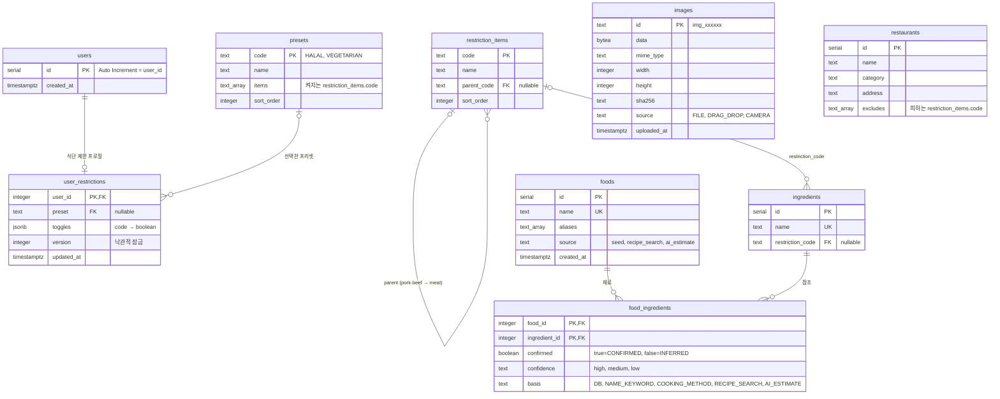

# ERD

> 문서 통일(2026-10-29) 때 `feat/base-settings` 브랜치의 실제 스키마(`lib/db/schema.ts`)에 맞춰 다시 썼다. 이 문서와 스키마가 다르면 [아래 "스키마에 반영할 것"](#스키마에-반영할-것)을 먼저 본다. 근거는 [problem.yaml](problem.yaml)의 `features`, [scenarios.yaml](scenarios.yaml), [api.md](api.md)다.

## 전제

- DB는 PostgreSQL 16, ORM은 Drizzle, 마이그레이션은 `drizzle/`(drizzle-kit로 생성)이다([tech-stack.md](tech-stack.md)). 서버가 시작될 때 `instrumentation.ts`가 마이그레이션과 시드를 실행한다.
- 회원과 로그인이 없다. 사용자는 서버가 Auto Increment로 발급한 `user_id`(숫자)로 구분한다. 발급은 `POST /api/v1/users`([api.md](api.md)).
- 사진은 `images.data`(bytea)에 저장한다. 해커톤 범위에서는 따로 지우지 않는다.
- **저장하지 않는 것:** 메뉴 판독 결과와 판정 결과. 요청마다 계산해서 돌려준다.

## 다이어그램

## 테이블

### 사용자와 식단 제한 (REQ-4)

| 테이블 | 설명 |
| --- | --- |
| `users` | 회원 정보 없이 사용자를 구분하는 번호. `POST /api/v1/users`가 한 행을 만든다 |
| `user_restrictions` | 사용자당 한 행. 마지막으로 고른 프리셋, 토글 상태(`toggles` jsonb), 낙관적 잠금용 `version` |
| `presets` | 프리셋 목록. `items`는 그 프리셋이 켜는 항목 코드 배열 |
| `restriction_items` | 토글 항목. `parent_code`로 위계를 둔다(`pork`·`beef` → `meat`) |

- **동시 요청(REQ-4):** 저장은 `UPDATE ... WHERE version = :요청한 version`으로 하고, 0행이 바뀌면 409를 준다. 처음 저장이 겹쳐 PK가 충돌해도 409를 준다.
- **사용자 제한 계산:** 프리셋 `items`를 켜고 `toggles`로 덮어쓴 뒤, 켜진 항목의 하위 항목(`parent_code`)까지 펼친다.

### 사진 (REQ-1, OPT-3)

| 테이블 | 설명 |
| --- | --- |
| `images` | 업로드한 사진 본문(`data`)과 메타데이터. OPT-3로 이미 줄어든 상태로 올라온다 |

### 음식 DB와 숨은 성분 (REQ-2, REQ-3, REQ-5, REQ-6, OPT-1)

| 테이블 | 설명 |
| --- | --- |
| `foods` | 음식 DB. `aliases`로 표기 차이(`돈까스`/`돈가스`)를 맞춘다. `source`는 시드(`seed`)·만개의 레시피(`recipe_search`)·AI 추정(`ai_estimate`) |
| `ingredients` | 재료 사전. `restriction_code`는 재료가 걸리는 가장 구체적인 제한 항목(돼지고기 → `pork`), 없으면 null |
| `food_ingredients` | 음식에 들어 있는 재료. REQ-6의 확인/추정이 `confirmed`, 확신도가 `confidence`, 출처가 `basis` |

- **판정은 코드가 한다.** 규칙은 [api.md](api.md) REQ-3 > 판정 규칙(`R0`~`R4`). 적용된 규칙은 응답에만 담고 저장하지 않는다.
- **DB에 없는 메뉴:** 만개의 레시피 또는 AI 추정으로 찾은 재료를 `foods`·`food_ingredients`에 저장해 다음 요청부터 DB에서 찾는다. 이때 `confirmed`는 항상 false다.

### 음식점 추천 (OPT-2)

| 테이블 | 설명 |
| --- | --- |
| `restaurants` | 팀이 조사한 학교 주변 음식점. `excludes`는 그 음식점이 쓰지 않는 항목 코드. 사용자 제한 항목을 모두 포함하는 음식점만 추천한다 |

## 시드 데이터 최소 요구

E2E 시나리오([scenarios.yaml](scenarios.yaml))가 돌아가려면 아래가 시드에 있어야 한다.

- **프리셋:** `HALAL`(할랄: `pork`, `alcohol`), `VEGETARIAN`(채식: `meat`, `seafood`)
- **토글 항목:** `meat`, `pork`(parent `meat`), `beef`(parent `meat`), `seafood`, `egg`, `dairy`, `peanut`, `alcohol`
- **음식(역할 ③):** 설렁탕, 콩나물국, 그린샐러드, 버섯리조또, 김치찌개
- **설렁탕:** 소고기(`beef`, `confirmed = true`). 채식 프리셋과 "고기" 토글 모두에서 "불가"(R1)와 소고기 근거가 나온다.
- **된장찌개는 넣지 않는다.** `manual-input-unknown-menu`가 DB에 없는 경로를 확인한다.
- **사진 판독:** 메뉴판 사진에서 읽힌 이름이 `foods.name` 또는 `aliases`와 일치해야 한다.

## 스키마에 반영할 것

`feat/base-settings`의 `lib/db/schema.ts`와 시드가 통일된 문서와 다른 곳이다. 역할 ①이 고친다.

1. `users.id`: 클라이언트가 만든 `uuid` → 서버가 발급하는 `serial`(Auto Increment). `user_restrictions.user_id`도 `integer`로 바꾼다. `POST /api/v1/users`를 추가한다.
2. `restriction_items.parent_code` 컬럼을 추가하고 `pork`·`beef`의 parent를 `meat`로 둔다.
3. 프리셋 `VEGAN`(비건: `meat`, `seafood`, `egg`, `dairy`) → `VEGETARIAN`(채식: `meat`, `seafood`).

## 열린 질문

1. **메뉴 이름 정규화.** 공백 제거와 `aliases` 외의 규칙(동의어 사전 등)은 역할 ③이 정한다.
2. **음식점 데이터.** 몇 곳을 넣을지와 조사 범위는 팀이 정한다.
